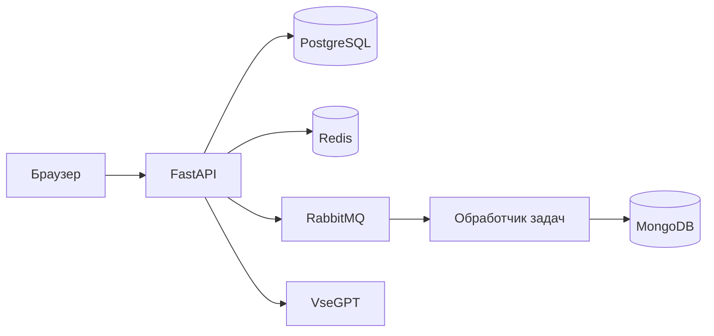

# План инфраструктуры SFMShop

## Учебный стенд Docker

Compose создаёт сеть `app_network`. PostgreSQL хранит пользователей, товары и заказы.
Redis кеширует каталог. RabbitMQ передаёт задачи обработчику, MongoDB сохраняет его
события. Письма, отчёты и дополнительное списание в обработчике пока являются
учебными сообщениями в лог. Реальный остаток меняется в транзакции создания заказа.
VseGPT нужен для помощника поддержки и требует отдельного ключа.

Все настройки основного приложения проходят через `Settings`.
Compose передаёт переменные контейнерам, Python внутри контейнеров отключает
загрузку `.env`. Приложение ждёт готовности PostgreSQL, Redis и RabbitMQ.

## Проверки и доставка изменений

1. Push или pull request запускает job `test`.
2. Устанавливаются зависимости, выполняются ruff, mypy и pytest.
3. Покрытие всего `src` должно быть не ниже 81%.
4. Job `deploy` собирает образ и поднимает отдельный стек в CI.
5. Скрипт `scripts/check_deployment.py` проверяет реальное взаимодействие API и БД.
6. Для публикации на VPS нужно добавить реестр образов и серверные доступы через GitHub Secrets.

Для публикации использовать тег образа с идентификатором коммита и хранить предыдущую
версию для отката. Базу резервировать перед миграциями. Развёртывание в GitHub Actions
и внешнем хостинге подтверждается отдельным успешным запуском этих сред.

## Переход на Kubernetes

В `k8s/` уже есть Deployment и Service. Переход имеет смысл при потребности
в нескольких узлах, автоматическом восстановлении и распределении нагрузки.
Подготовка кластера включает

- доступный реестр образов и конкретный тег в Deployment,
- Secret `sfmshop-secrets` с паролем БД, ключом JWT и доступом к очереди,
- PostgreSQL и Redis с адресами, совпадающими с настройками Deployment,
- RabbitMQ, отдельный Deployment обработчика и MongoDB для его логов,
- Ingress с HTTPS, лимиты CPU и памяти, резервное копирование данных.

`/health/live` используется для перезапуска зависшего процесса, `/health/ready`
для допуска трафика. При отказе БД readiness возвращает 503, при отказе кеша
приложение работает через PostgreSQL. Полный Kubernetes-стенд пока не запускался.

## Ограничения учебного решения

Фоновая отправка задач выполняется после транзакции создания заказа. При сбое между
записью заказа и публикацией задачи уведомление может потеряться. Для промышленной
доставки событий понадобится transactional outbox и идемпотентные обработчики.
Это запись события в той же транзакции с заказом и безопасное повторное выполнение.
Сейчас обработчики имитируют действия и используют повторы с очередью ошибок.

Отдельная папка `order-service/` демонстрирует HTTP-взаимодействие с внешним
payment-service. В основном Compose разворачивается приложение `src.api.main`.
Полноценная интеграция самостоятельного сервиса заказов потребует реализации
и настройки payment-service.
